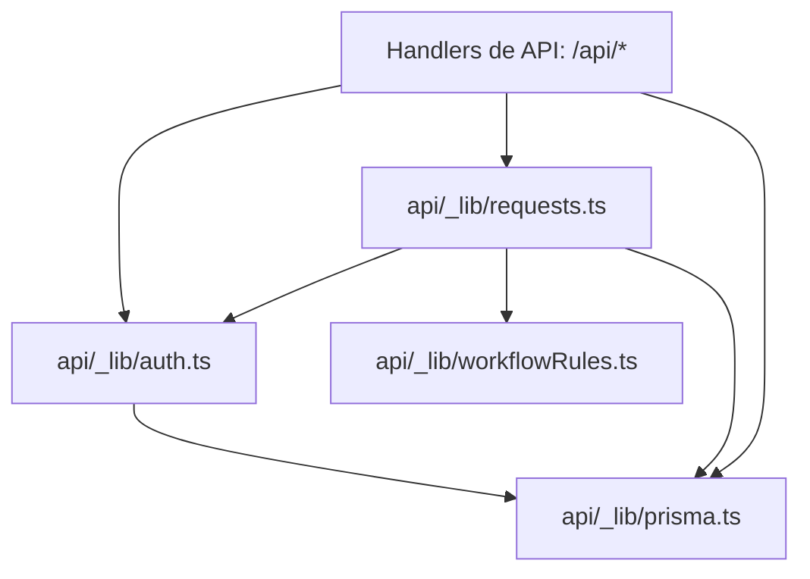
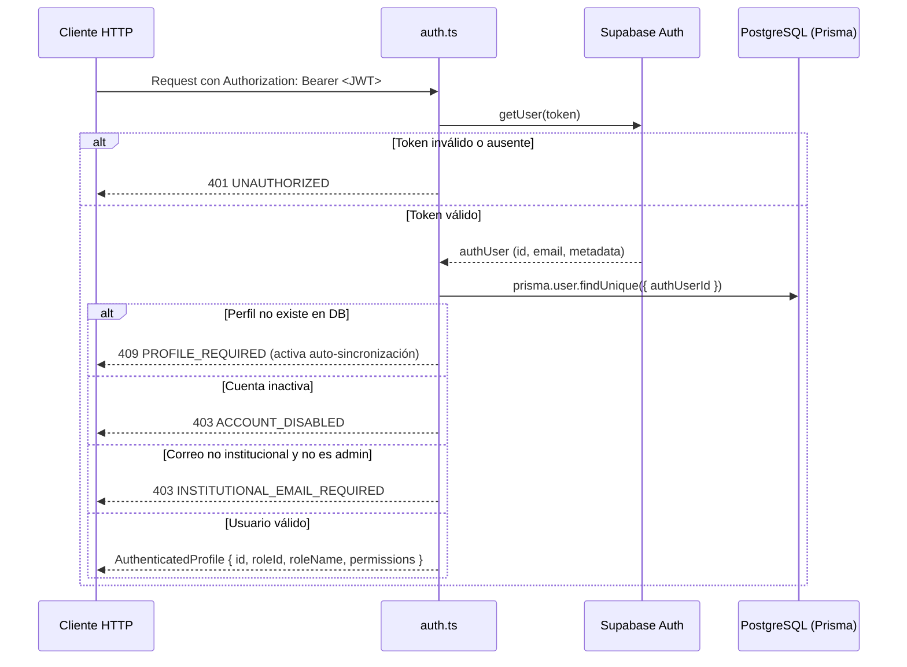
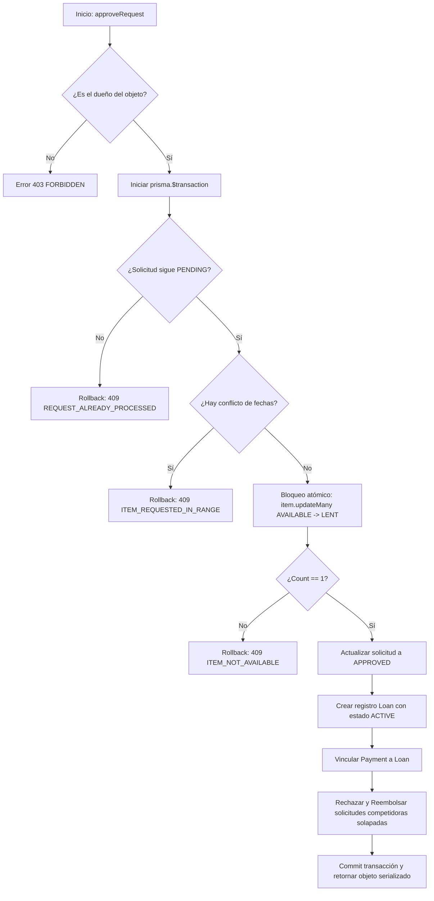

# Módulo de Utilidades y Lógica de Dominio del Backend (`api/_lib`)

Esta carpeta constituye el núcleo de infraestructura y reglas de negocio del backend serverless de LendIt UJAP. Administra la conexión a PostgreSQL con Prisma, la autenticación y permisos con Supabase, la lógica transaccional de préstamos y las funciones puras de dominio.

---

## 1. Arquitectura de Módulos



---

## 2. Especificación Detallada de Archivos y Funciones

### `auth.ts` — Autenticación, Perfiles y Control de Acceso

#### Flujo de Resolución de Identidad (`getAuthenticatedProfile`)



#### Funciones y Métodos

| Función | Parámetros | Retorno | Comportamiento y Validaciones |
|---|---|---|---|
| `getServerClient()` | Ninguno | `SupabaseClient` | Instancia singleton configurada con `SUPABASE_URL` y `SUPABASE_PUBLISHABLE_KEY`. Desactiva `autoRefreshToken` y `persistSession` para optimizar entornos de ejecución efímeros serverless. |
| `getAuthorizationHeader(req)` | `req: ApiRequest` | `string \| null` | Extrae de forma segura el encabezado `authorization`, admitiendo formatos de valor simple o array de cabeceras. |
| `getAuthenticatedUser(req)` | `req: ApiRequest` | `Promise<{ user, error }>` | Extrae el token `Bearer <jwt>` y lo valida contra `supabase.auth.getUser()`. Si las variables no están configuradas retorna `AUTH_NOT_CONFIGURED`. Si el token expiró o es inválido retorna `UNAUTHORIZED`. |
| `isInstitutionalEmail(email)` | `email: string` | `boolean` | Valida mediante regex `/^[^\s@]+@ujap\.edu\.ve$/i` que el correo pertenezca estrictamente al dominio de la Universidad José Antonio Páez. |
| `isAdministrativeRole(roleName, permissions)` | `roleName: string`, `permissions: string[]` | `boolean` | Devuelve `true` si `roleName === 'ADMIN'` o si la lista de permisos contiene `'roles.manage'`. |
| `getAuthenticatedProfile(req)` | `req: ApiRequest` | `Promise<{ profile, error }>` | Coordina la autenticación con Supabase y la consulta en Prisma de la tabla `User`. Valida que `isActive` sea verdadero y que el correo sea institucional (o cuente con rol administrativo). Retorna el perfil resuelto con su matriz aplanada de permisos (`permissions: string[]`). |
| `hasPermission(profile, key)` | `profile: AuthenticatedProfile`, `key: string` | `boolean` | Verifica si una clave de permiso (ej. `'items.publish'`, `'roles.manage'`) existe en la matriz del usuario. |
| `statusForProfileError(error)` | `error: string` | `number` | Mapeo de errores de autenticación a códigos de estado HTTP estándar: `AUTH_NOT_CONFIGURED` $\to$ 500, `PROFILE_REQUIRED` $\to$ 409, `ACCOUNT_DISABLED` $\to$ 403, `INSTITUTIONAL_EMAIL_REQUIRED` $\to$ 403, otros $\to$ 401. |

---

### `requests.ts` — Máquina de Estados y Ciclo de Vida de Préstamos

Centraliza todas las mutaciones sobre solicitudes y préstamos garantizando **atomicidad mediante transacciones (`prisma.$transaction`)** para prevenir condiciones de carrera (*race conditions*).

#### Flujo Transaccional de Aprobación (`approveRequest`)



#### Funciones y Métodos

| Función | Parámetros | Retorno | Comportamiento y Validaciones |
|---|---|---|---|
| `serializeRequest(request, profileId)` | `request: RequestRecord`, `profileId: string` | Objeto serializado | Transforma los registros relacionales de Prisma en la interfaz esperada por el cliente. Calcula dinámicamente `isOwner`, formatea fechas a cadenas ISO y parsea montos decimales a números flotantes. |
| `parseDateRange(startsAt, endsAt)` | `startsAt: string`, `endsAt: string` | `{ starts: Date, ends: Date }` | Parsea las fechas y las somete a las validaciones de `requestDateError()`. Lanza `RequestWorkflowError(400)` si las fechas son inválidas. |
| `listRequests(profile, res)` | `profile: AuthenticatedProfile`, `res: ApiResponse` | `Promise<void>` | Retorna las solicitudes donde el usuario es el solicitante (`requesterId === profile.id`) o el propietario del objeto (`item.ownerId === profile.id`), con orden cronológico descendente y límite de 100 registros. |
| `handleRequestMutation(req, res, profile)` | `req`, `res`, `profile` | `Promise<void>` | Valida el permiso `'items.rent'`. Enruta métodos `POST` hacia `createRequest` y `PATCH` hacia `updateRequest`. Captura errores de negocio `RequestWorkflowError` mapeando su código HTTP correspondiente. |
| `createRequest(req, res, profile)` | `req`, `res`, `profile` | `Promise<void>` | Valida con Zod: verifica que el objeto exista, esté `AVAILABLE`, pertenezca a la audiencia del rol del solicitante, previene auto-préstamos (`ownerId !== profile.id`) y verifica que no existan solicitudes `PENDING` o `APPROVED` en el rango de fechas. Si es `RENTAL`, genera un pago simulado `SIMULATED_PAID`. |
| `updateRequest(req, res, profile)` | `req`, `res`, `profile` | `Promise<void>` | Valida acciones admitidas: `'approve'`, `'reject'`, `'cancel'`, `'return'`. Comprueba que solo el dueño pueda aprobar/rechazar y solo el prestatario pueda cancelar una solicitud pendiente. |
| `approveRequest(requestId, res, profile)` | `requestId: string`, `res`, `profile` | `Promise<void>` | Ejecuta la transacción atómica descrita en el diagrama: reclama el artículo cambiando su estado a `LENT`, aprueba la solicitud, crea el préstamo `ACTIVE`, y rechaza automáticamente con reembolso las demás solicitudes en conflicto de fechas. |
| `rejectOrCancelRequest(requestId, action, res, profile)` | `requestId`, `action`, `res`, `profile` | `Promise<void>` | Modifica atómicamente el estado a `REJECTED` o `CANCELLED` y cambia los pagos asociados a `REFUNDED`. |
| `returnLoan(loanId, res, profile)` | `loanId`, `res`, `profile` | `Promise<void>` | Marca el préstamo activo como `RETURNED`, registra la fecha y hora de entrega (`returnedAt: new Date()`) y restaura el estado del artículo a `AVAILABLE`. |

---

### `workflowRules.ts` — Reglas de Negocio Puras

Funciones matemáticas y lógicas completamente aisladas de I/O y base de datos, ideales para pruebas unitarias deterministas.

| Función | Firma | Regla de Negocio Implementada |
|---|---|---|
| `canManageOwnedResource` | `(ownerId: string, actorId: string, permissions: string[]): boolean` | Un usuario puede modificar un recurso si es el dueño directo (`ownerId === actorId`) o si posee el permiso administrativo `'users.manage'`. |
| `canSeeRestrictedItem` | `(visibleRoleIds: string[], actorRoleId: string): boolean` | Si `visibleRoleIds` está vacío, el objeto es público para todos los roles. Si contiene elementos, el rol del actor debe estar presente en el conjunto de roles autorizados. |
| `rangesOverlap` | `(start: Date, end: Date, otherStart: Date, otherEnd: Date): boolean` | Comprueba solapamiento temporal continuo: `start < otherEnd && end > otherStart`. |
| `requestDateError` | `(startsAt: Date, endsAt: Date, now = new Date()): string \| null` | - Retorna `'INVALID_REQUEST_DATES'` si alguna fecha es NaN, si `startsAt < now - 60s` (en el pasado) o si `endsAt <= startsAt`.<br>- Retorna `'REQUEST_RANGE_TOO_LONG'` si el préstamo supera los 90 días corridos.<br>- Retorna `null` si el rango es válido. |

---

### `prisma.ts` — Gestión del Pool de Conexión

Implementa el patrón Singleton sobre el objeto global de Node.js (`globalThis`) para evitar la saturación de conexiones en PostgreSQL durante el desarrollo local (hot reload) y en ejecuciones serverless concurrentes.

```typescript
// Reutiliza la instancia existente o crea una nueva con el adaptador de pg
export const prisma = globalForPrisma.lenditPrisma ?? createPrismaClient()
if (process.env.NODE_ENV !== "production") {
  globalForPrisma.lenditPrisma = prisma
}
```
