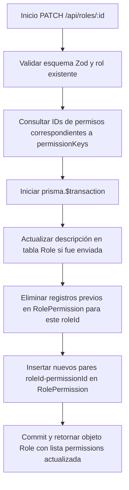

# Gestión de Roles Específicos (`api/roles/`)

Esta carpeta contiene los endpoints dinámicos para operaciones directas sobre un rol individual del sistema identificado por su UUID en la URL (`/api/roles/:id`).

---

## 1. Métodos Soportados y Permisos

| Método HTTP | Permiso Requerido | Acción Realizada |
|---|---|---|
| `PATCH` | `roles.manage` | Modificación de la descripción y reasignación completa de permisos de un rol. |
| `DELETE` | `roles.manage` | Eliminación permanente de un rol personalizado. |

---

## 2. Controlador `[id].ts` (`/api/roles/:id`)

### Esquema de Validación de Entrada (`updateRoleSchema`)
```typescript
const updateRoleSchema = z.object({
  description: z.string().trim().max(300).optional(),
  permissionKeys: z.array(z.string()),
})
```

### Reglas de Protección de Roles
La constante `PROTECTED_ROLE_NAMES = ['ADMIN', 'STUDENT', 'PROFESSOR']` define los roles mínimos estructurales del sistema.
1. **Intento de Eliminación de Rol Protegido**: Si un administrador intenta ejecutar `DELETE /api/roles/:id` sobre cualquiera de estos tres roles, el handler rechaza la solicitud inmediatamente con código HTTP 409 y mensaje de error `ROLE_PROTECTED`.
2. **Intento de Eliminación de Rol en Uso**: Si el rol no está protegido pero existen usuarios que actualmente tienen asignado este rol (`prisma.user.count({ where: { roleId: id } }) > 0`), el handler bloquea la operación respondiendo `409 ROLE_IN_USE`.

---

## 3. Lógica Transaccional de Actualización (`PATCH`)

La actualización de permisos es una operación atómica dentro de una transacción `prisma.$transaction`:



### Ejemplo de Petición (`PATCH /api/roles/:id`)
```json
{
  "description": "Estudiantes autorizados para coordinar laboratorios",
  "permissionKeys": [
    "items.publish",
    "items.rent",
    "profile.update"
  ]
}
```

### Ejemplo de Respuesta Exitosa (`HTTP 200`)
```json
{
  "ok": true,
  "role": {
    "id": "c1f7a8b2-3d4e-...",
    "name": "PREFECTO_LABORATORIO",
    "description": "Estudiantes autorizados para coordinar laboratorios",
    "permissions": [
      "items.publish",
      "items.rent",
      "profile.update"
    ]
  }
}
```

---

## 4. Matriz de Errores Comunes

| Código HTTP | Error (`errorCode`) | Causa |
|---|---|---|
| `400` | `MISSING_ROLE_ID` | No se especificó el parámetro `:id` en la ruta. |
| `400` | `INVALID_ROLE_UPDATE` | La carga útil no cumple con el esquema Zod. |
| `403` | `FORBIDDEN` | El usuario no posee el permiso administrativo `roles.manage`. |
| `404` | `ROLE_NOT_FOUND` | No se encontró ningún rol con el UUID provisto. |
| `409` | `ROLE_PROTECTED` | Intento de eliminar `ADMIN`, `STUDENT` o `PROFESSOR`. |
| `409` | `ROLE_IN_USE` | Hay estudiantes o profesores que tienen asignado este rol actualmente. |
| `500` | `ROLE_UPDATE_FAILED` | Excepción no controlada durante la transacción en base de datos. |
