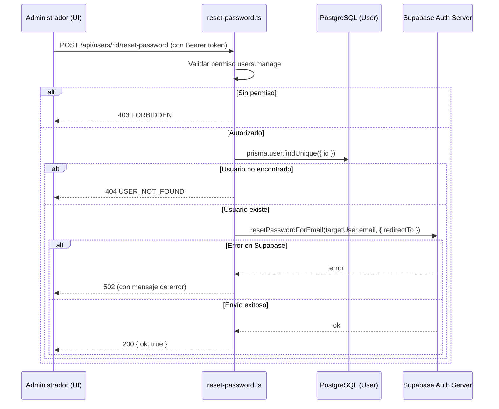

# Acciones sobre Usuarios Específicos (`api/users/[id]/`)

Esta subcarpeta contiene endpoints para acciones administrativas operativas sobre un usuario puntual identificado por su UUID en la URL.

---

## 1. Controlador `reset-password.ts` (`POST /api/users/:id/reset-password`)

Permite a los administradores de la red iniciar de forma segura el restablecimiento de credenciales de cualquier miembro del campus sin manipular directamente su contraseña.

### Diagrama de Secuencia

---

## 2. Parámetros y Variables de Entorno

- **Parámetro de Ruta**: `:id` (UUID del usuario en la tabla `User`).
- **Variables de Entorno Utilizadas**:
  - `SUPABASE_URL`: Dirección base del proyecto Supabase.
  - `SUPABASE_PUBLISHABLE_KEY`: Clave pública para instanciar el cliente temporal de Supabase.
  - `APP_URL`: URL base de la aplicación frontend a la que el usuario será redirigido al pulsar el enlace recibido en su correo electrónico institucional.

---

## 3. Matriz de Códigos de Error

| Código HTTP | Error (`errorCode`) | Causa |
|---|---|---|
| `400` | `MISSING_USER_ID` | Identificador `:id` no provisto en la petición. |
| `403` | `FORBIDDEN` | El solicitante carece del permiso `users.manage`. |
| `404` | `USER_NOT_FOUND` | No existe ningún usuario con el identificador indicado. |
| `405` | `METHOD_NOT_ALLOWED` | Método HTTP distinto a `POST`. |
| `500` | `AUTH_NOT_CONFIGURED` | Faltan variables de entorno para inicializar Supabase. |
| `502` | Mensaje de Supabase | Supabase rechazó la solicitud (ej. límite de correos superado o SMTP no disponible). |
