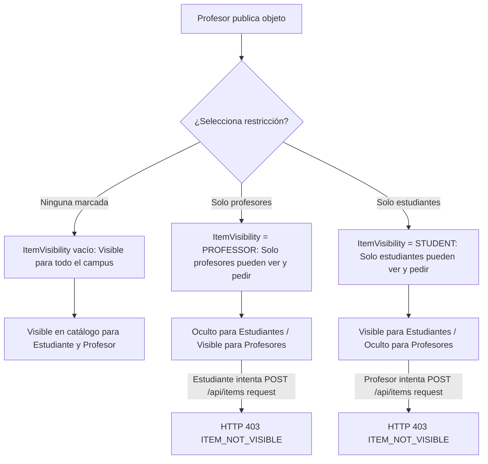

# Auditoría Técnica y Propuesta de Arquitectura: Rol y Perfil PROFESSOR — LendIt UJAP

**Fecha:** 25 de octubre de 2026
**Entorno auditado:** Local (`checkout` en rama `fix/users-login`)
**Documento base:** `docs/professor-review.md`
**Estado:** Documento de auditoría y propuesta arquitectónica. **No constituye autorización de implementación ni alteración de datos existentes.**

---

## 1. Alcance, Contexto y Límites de la Auditoría

De conformidad con las instrucciones de la orden de trabajo y las reglas de gobernanza de `AGENTS.md`:
1. **Sin mutación de datos ni perfiles:** Se preservan intactas las sesiones activas en Orca Browser (`jpena@ujap.edu.ve`, `estudiante@ujap.edu.ve` y `jesusp2095@gmail.com`). No se modificaron cuentas, no se asignaron roles forzados a usuarios existentes ni se aplicaron migraciones a la base de datos.
2. **Limitación de sesión docente documentada:** No existe en la base de datos local actual ningún usuario activo autenticado con el rol `PROFESSOR` (todos los usuarios existentes son `STUDENT` o `ADMIN`). Por consiguiente, esta auditoría distingue de forma explícita entre **análisis estático y de contratos verificado en código/base de datos** y **flujos futuros pendientes de ejecución**.
3. **Referencias normativas de diseño:** Para las evaluaciones de interfaz se han tomado como marco vinculante el sistema de diseño de LendIt UJAP (`design-system/lendit-ujap/MASTER.md`), los estándares de tokens de `src/style.css`, las guías de usabilidad accesible y el catálogo de componentes existentes.

---

## 2. Contraste de Extremo a Extremo: `PROFESSOR` vs `STUDENT` vs `ADMIN`

| Dimensión | `STUDENT` (Estudiante) | `PROFESSOR` (Profesor) | `ADMIN` (Administrador) | Evidencia en Código / BD |
| :--- | :--- | :--- | :--- | :--- |
| **Propósito de Dominio** | Alumno activo que pide y presta objetos para sus asignaturas y vida universitaria. | Docente que comparte o solicita material académico, bibliográfico o técnico. | Gestor de plataforma que administra catálogo, facultades, carreras, usuarios y roles. | [`MASTER.md`](file:///C:/Users/jpena/Documents/Proyectos%20Personales/lendit-ujap/design-system/lendit-ujap/MASTER.md#L5); [`schema.prisma`](file:///C:/Users/jpena/Documents/Proyectos%20Personales/lendit-ujap/prisma/schema.prisma#L50-L72) |
| **Asignación en Registro** | Por defecto o radio button "Estudiante". | Por radio button "Profesor" sin verificación. | **Prohibido:** El trigger rechaza `ADMIN` y lo degrada a `STUDENT`. | [`RegisterForm.vue` L41, L193-L198](file:///C:/Users/jpena/Documents/Proyectos%20Personales/lendit-ujap/src/components/RegisterForm.vue#L41); [Migración `20260916010000` L14-L20](file:///C:/Users/jpena/Documents/Proyectos%20Personales/lendit-ujap/prisma/migrations/20260916010000_signup_trigger_stores_photo/migration.sql#L14-L20) |
| **Permisos Efectivos (`RolePermission`)** | 4 permisos: `profile.update`, `items.publish`, `items.rent`, `reviews.create`. | **Idénticos 4 permisos:** `profile.update`, `items.publish`, `items.rent`, `reviews.create`. | **8 permisos:** Los 4 base + `roles.manage`, `categories.manage`, `careers.manage`, `users.manage`. | [Migración `20260915030000` L84-L95](file:///C:/Users/jpena/Documents/Proyectos%20Personales/lendit-ujap/prisma/migrations/20260915030000_roles_permissions_categories_careers/migration.sql#L84-L95) |
| **Adscripción Académica** | `careerId` obligatorio apuntando a `Career` (ej. "Ingeniería en Computación"). | `careerId` **obligatorio** forzado por esquema (`NOT NULL`). Sin soporte de Facultad/Departamento. | `careerId` obligatorio en base de datos; la UI administrativa lo ignora. | [`schema.prisma` L129](file:///C:/Users/jpena/Documents/Proyectos%20Personales/lendit-ujap/prisma/schema.prisma#L129); [`api/me.ts` L16, L149-L151](file:///C:/Users/jpena/Documents/Proyectos%20Personales/lendit-ujap/api/me.ts#L16); [`AccountView.vue` L112](file:///C:/Users/jpena/Documents/Proyectos%20Personales/lendit-ujap/src/views/AccountView.vue#L112) |
| **Rutas Marketplace (`/publicar`, `/solicitudes`, `/mis-publicaciones`)** | Totalmente permitidas. | **Totalmente permitidas.** | **Bloqueadas:** Redirige a `/admin` y responde HTTP 403 `ADMIN_MARKETPLACE_FORBIDDEN`. | [`src/main.ts` L62-L64](file:///C:/Users/jpena/Documents/Proyectos%20Personales/lendit-ujap/src/main.ts#L62-L64); [`api/items.ts` L180, L189, L223, L232](file:///C:/Users/jpena/Documents/Proyectos%20Personales/lendit-ujap/api/items.ts#L180) |
| **Consumo de Catálogo (`/catalogo`)** | Completo: ve objetos públicos y de audiencia `STUDENT`. Puede solicitar. | Completo: ve objetos públicos y de audiencia `PROFESSOR`. Puede solicitar. | **Solo lectura:** Ve todo (incluyendo restringidos), pero tiene botones de solicitud deshabilitados. | [`api/items.ts` L192, L203-L207](file:///C:/Users/jpena/Documents/Proyectos%20Personales/lendit-ujap/api/items.ts#L192); [`CatalogView.vue` L64](file:///C:/Users/jpena/Documents/Proyectos%20Personales/lendit-ujap/src/views/CatalogView.vue#L64); [`ArticleCard.vue` L21](file:///C:/Users/jpena/Documents/Proyectos%20Personales/lendit-ujap/src/components/ArticleCard.vue#L21) |
| **Publicación con Audiencia (`restrictedToRoles`)** | Puede marcar "Solo estudiantes", "Solo profesores" o público. | Puede marcar "Solo estudiantes", "Solo profesores" o público. | Prohibido publicar objetos. | [`PublishArticleForm.vue` L259-L264](file:///C:/Users/jpena/Documents/Proyectos%20Personales/lendit-ujap/src/components/PublishArticleForm.vue#L259-L264); [`api/items.ts` L302-L305](file:///C:/Users/jpena/Documents/Proyectos%20Personales/lendit-ujap/api/items.ts#L302-L305) |
| **Pagos Simulados (`/api/payments`)** | Autorizado para pagar y recibir pagos simulados. | **Autorizado** para pagar y recibir pagos simulados. | Bloqueado (`ADMIN_MARKETPLACE_FORBIDDEN`). | [`api/payments.ts` L63, L140](file:///C:/Users/jpena/Documents/Proyectos%20Personales/lendit-ujap/api/payments.ts#L63) |
| **Mensajería y Chat en Tiempo Real (`/mensajes`)** | Autorizado bidireccional; restringido por audiencia en consultas. | **Autorizado** bidireccional; restringido por audiencia en consultas. | Bloqueado (`ADMIN_MARKETPLACE_FORBIDDEN`). | [`api/messages.ts` L18, L33](file:///C:/Users/jpena/Documents/Proyectos%20Personales/lendit-ujap/api/messages.ts#L18) |
| **Credencial / Carnet (`/cuenta/carnet`)** | **Habilitado:** Consulta, carga y eliminación en bucket privado `student-cards`. | **Completamente bloqueado:** RLS PostgreSQL niega acceso; router redirige a `/cuenta/perfil`; UI oculta pestaña. | Bloqueado (no aplica a administradores). | [Migración `20261025050000` L11-L13](file:///C:/Users/jpena/Documents/Proyectos%20Personales/lendit-ujap/prisma/migrations/20261025050000_private_student_cards/migration.sql#L11-L13); [`src/main.ts` L58-L60](file:///C:/Users/jpena/Documents/Proyectos%20Personales/lendit-ujap/src/main.ts#L58-L60); [`AccountView.vue` L21](file:///C:/Users/jpena/Documents/Proyectos%20Personales/lendit-ujap/src/views/AccountView.vue#L21) |
| **Panel de Administración (`/admin`)** | Acceso denegado (`/admin/acceso-denegado`). | **Acceso denegado** (`/admin/acceso-denegado`). | Acceso total según permisos asignados. | [`src/main.ts` L46-L52](file:///C:/Users/jpena/Documents/Proyectos%20Personales/lendit-ujap/src/main.ts#L46-L52); [`src/router/index.ts` L48-L60](file:///C:/Users/jpena/Documents/Proyectos%20Personales/lendit-ujap/src/router/index.ts#L48-L60) |

---

## 3. Análisis de Registro, Metadatos y Asignación de Roles

### 3.1. Funcionamiento del Trigger en Supabase Auth
El flujo de creación de cuentas se delega a la función PostgreSQL `public.handle_new_auth_user()` activada tras `INSERT` en `auth.users`:

```sql
-- prisma/migrations/20260916010000_signup_trigger_stores_photo/migration.sql (Líneas 14-20)
requested_role := UPPER(COALESCE(NEW.raw_user_meta_data ->> 'role', 'STUDENT'));
IF requested_role NOT IN ('STUDENT', 'PROFESSOR') THEN
  requested_role := 'STUDENT';
END IF;

SELECT id INTO resolved_role_id FROM "Role" WHERE name = requested_role;
```

### 3.2. ¿Existe elevación de privilegios no deseada?
- **Hacia rol Administrador (`ADMIN`): NO existe elevación.**
  Cualquier intento de inyectar `role: 'ADMIN'` en `raw_user_meta_data` mediante clientes HTTP o llamadas directas a Supabase Auth es interceptado por la cláusula `IF requested_role NOT IN ('STUDENT', 'PROFESSOR')`, forzando el valor a `STUDENT`.
- **Hacia rol Profesor (`PROFESSOR`): SÍ existe auto-asignación sin validación.**
  Cualquier persona que posea una dirección de correo institucional `@ujap.edu.ve` (incluyendo alumnos de pregrado o personal administrativo) puede seleccionar la opción "Profesor" en el formulario de registro ([`RegisterForm.vue` L197](file:///C:/Users/jpena/Documents/Proyectos%20Personales/lendit-ujap/src/components/RegisterForm.vue#L197)) o enviar `{ role: 'PROFESSOR' }` en los metadatos de registro. El sistema asigna automáticamente el rol `PROFESSOR` en la base de datos sin requerir:
  - Verificación de nómina o confirmación del departamento de Recursos Humanos/Decanato.
  - Carga de credencial docente previa.
  - Aprobación manual de un administrador.

### 3.3. Vías administrativas de asignación de roles
Es un error común asumir que `roles.manage` es la vía para asignar un rol a un usuario:
1. `roles.manage`: Permite **crear nuevos roles y modificar qué permisos posee cada rol** en la tabla `RolePermission` ([`api/roles/[id].ts` L30](file:///C:/Users/jpena/Documents/Proyectos%20Personales/lendit-ujap/api/roles/[id].ts#L30)).
2. `users.manage`: Es el permiso que **permite cambiar el `roleId` de un usuario específico** mediante `PATCH /api/users/:id` ([`api/users/[id].ts` L27, L57](file:///C:/Users/jpena/Documents/Proyectos%20Personales/lendit-ujap/api/users/[id].ts#L27)).
3. `scripts/promote-user.ts`: Herramienta CLI de servidor que actualiza directamente `User.roleId` mediante Prisma sin pasar por la capa HTTP ([`scripts/promote-user.ts` L21-L25](file:///C:/Users/jpena/Documents/Proyectos%20Personales/lendit-ujap/scripts/promote-user.ts#L21-L25)).

---

## 4. Auditoría de Adscripción Académica: Exigencia de `careerId`

### 4.1. Diagnóstico del Modelo Actual (Estático)
1. **Obligatoriedad estricta en Base de Datos:**
   En [`prisma/schema.prisma` L129](file:///C:/Users/jpena/Documents/Proyectos%20Personales/lendit-ujap/prisma/schema.prisma#L129), la columna `careerId` en `User` es de tipo `UUID` **no nula** con restricción de clave foránea a `Career` (`onDelete: Restrict`).
2. **Fallback silencioso en Trigger:**
   Si en el registro no se envía un `careerId` válido, el trigger ejecuta:
   ```sql
   -- prisma/migrations/20260916010000_signup_trigger_stores_photo/migration.sql (Líneas 28-30)
   IF resolved_career_id IS NULL THEN
     SELECT id INTO resolved_career_id FROM "Career" ORDER BY name LIMIT 1;
   END IF;
   ```
   Esto asigna silenciosamente la primera carrera en orden alfabético ("Ingeniería Civil") a cualquier usuario.
3. **Formulario de Registro forzado:**
   En [`RegisterForm.vue` L49, L180-L182](file:///C:/Users/jpena/Documents/Proyectos%20Personales/lendit-ujap/src/components/RegisterForm.vue#L49), el campo "Carrera" es obligatorio independientemente de si se seleccionó "Estudiante" o "Profesor".
4. **Formulario de Perfil y Textos Estudiantiles:**
   En [`AccountView.vue` L112](file:///C:/Users/jpena/Documents/Proyectos%20Personales/lendit-ujap/src/views/AccountView.vue#L112), el selector sigue etiquetado como "Carrera", acompañado del texto de ayuda:
   *`"Mantén tu carrera actualizada si cambias de programa académico."`*
   Esto resulta conceptualmente inapropiado para el cuerpo docente.

### 4.2. Propuesta Arquitectónica Aditiva (Aún NO Aprobada)
Para modelar fielmente la estructura universitaria de la UJAP sin romper registros históricos ni perfiles existentes:

```
┌────────────────────────────────────────────────────────┐
│                   ESTRUCTURA DOCENTE                   │
├────────────────────────┬───────────────────────────────┤
│ Entidad Actual         │ Propuesta Aditiva             │
├────────────────────────┼───────────────────────────────┤
│ School (Facultad/Esc.) │ User.schoolId (UUID Nullable) │
│ Career (Carrera/Prog.) │ User.careerId (UUID Nullable) │
│ —                      │ User.department (VARCHAR 120) │
└────────────────────────┴───────────────────────────────┘
```

#### Reglas de Validación Propuestas:
- **Si `Role = 'STUDENT'`:** `careerId` continúa siendo obligatorio; `schoolId` se deriva automáticamente de `Career.schoolId`.
- **Si `Role = 'PROFESSOR'`:** `schoolId` (Facultad / Escuela) es obligatorio; `careerId` pasa a ser opcional (un profesor puede impartir clases en una carrera específica o en cátedras transversales como Matemáticas o Física); se añade un campo de texto libre `department` opcional (ej. *"Cátedra de Algoritmos y Programación"* o *"Departamento de Ciencias Básicas"*).
- **Retrocompatibilidad:** En la base de datos, `careerId` se flexibiliza a opcional (`UUID?`), y una migración aditiva completa `User.schoolId = Career.schoolId` para los registros actuales, garantizando que ninguna consulta existente falle.

---

## 5. Auditoría de Credencial Universitaria / Carnet Docente

### 5.1. Estado Actual de la Implementación
1. **Bucket y Políticas RLS Exclusivas para Estudiantes:**
   En la migración [`20261025050000_private_student_cards` L11-L13, L17-L19](file:///C:/Users/jpena/Documents/Proyectos%20Personales/lendit-ujap/prisma/migrations/20261025050000_private_student_cards/migration.sql#L11-L13), la política de seguridad RLS en `storage.objects` contiene:
   ```sql
   AND EXISTS (SELECT 1 FROM public."User" u JOIN public."Role" r ON r.id = u."roleId"
     WHERE u."authUserId" = auth.uid() AND u."isActive" AND r.name = 'STUDENT')
   ```
   **Consecuencia técnica:** Si un usuario con rol `PROFESSOR` intenta invocar `client.storage.from('student-cards').upload()` o `list()`, la API de Supabase Storage responde con error de autorización (403 Forbidden).
2. **Bloqueo en Enrutador Frontend:**
   En [`src/main.ts` L58-L60](file:///C:/Users/jpena/Documents/Proyectos%20Personales/lendit-ujap/src/main.ts#L58-L60):
   ```ts
   if (to.name === 'account' && to.params.section === 'carnet' && (authStore.isAdmin || authStore.user?.role !== 'STUDENT')) {
     return { name: 'account', params: { section: 'perfil' } }
   }
   ```
   Cualquier navegación directa a `/cuenta/carnet` por parte de un profesor es redirigida a `/cuenta/perfil`.
3. **Omisión en la Barra Lateral de Mi Cuenta:**
   En [`AccountView.vue` L21](file:///C:/Users/jpena/Documents/Proyectos%20Personales/lendit-ujap/src/views/AccountView.vue#L21), la pestaña "Carnet universitario" solo se añade al menú si `auth.user?.role === 'STUDENT'`.
4. **Verificación inexistente:**
   No existe actualmente ningún servicio de OCR, validación biométrica, cotejo con base de datos universitaria ni interfaz administrativa para marcar carnets como "Aprobados" o "Rechazados". El estado actual es simplemente un archivo privado almacenado en `student-cards/<userId>/carnet`.

### 5.2. Propuesta de Credencial Académica Privada
1. **Ampliación de Seguridad RLS:**
   Modificar la política RLS en `storage.objects` para que admita `r.name IN ('STUDENT', 'PROFESSOR')`. El almacenamiento se mantiene estrictamente privado:
   - Solo el propietario del carnet puede subirlo, consultarlo o eliminarlo mediante URLs firmadas de duración limitada (300 segundos).
   - Ningún tercero puede visualizar la credencial docente.
2. **Adaptación de la Interfaz (`AccountView.vue` y `StudentCardPanel.vue`):**
   - Habilitar la sección para profesores con título adaptado: *"Credencial Universitaria"* o *"Carnet Docente / Acreditación"*.
   - Texto de ayuda: *"Sube una foto de tu carnet docente o constancia institucional de la UJAP para respaldar tus intercambios en la comunidad."*.

---

## 6. Auditoría de Permisos y Audiencia de Objetos (`ItemVisibility`)

### 6.1. Matriz de Permisos Base
Tanto `STUDENT` como `PROFESSOR` tienen exactamente los mismos permisos asignados en `RolePermission`:
- `profile.update`: Puede actualizar nombre, apellido, teléfono y foto ([`api/me.ts` L107](file:///C:/Users/jpena/Documents/Proyectos%20Personales/lendit-ujap/api/me.ts#L107)).
- `items.publish`: Puede crear y editar publicaciones ([`api/items.ts` L233](file:///C:/Users/jpena/Documents/Proyectos%20Personales/lendit-ujap/api/items.ts#L233)).
- `items.rent`: Puede crear solicitudes de préstamo y alquiler ([`api/_lib/requests.ts` L181](file:///C:/Users/jpena/Documents/Proyectos%20Personales/lendit-ujap/api/_lib/requests.ts#L181)).
- `reviews.create`: Puede emitir calificaciones de confianza.

### 6.2. Mecanismo de Audiencia de Publicaciones
El filtrado de audiencia opera mediante la tabla `ItemVisibility` (`itemId`, `roleId`):



### 6.3. Validación en Endpoints Clave
- **Catálogo (`GET /api/items`):**
  [`api/items.ts` L203-L207](file:///C:/Users/jpena/Documents/Proyectos%20Personales/lendit-ujap/api/items.ts#L203-L207) filtra con `OR: [{ visibleToRoles: { none: {} } }, { visibleToRoles: { some: { roleId: profile.roleId } } }]`. Un profesor no ve publicaciones restringidas exclusivamente a estudiantes, y viceversa.
- **Creación de Solicitud (`POST /api/items` con `resource: 'request'`):**
  [`api/_lib/requests.ts` L229-L231](file:///C:/Users/jpena/Documents/Proyectos%20Personales/lendit-ujap/api/_lib/requests.ts#L229-L231) invoca `canSeeRestrictedItem`. Si el rol del solicitante no coincide, responde HTTP 403 `ITEM_NOT_VISIBLE`.
- **Inicio de Chat de Consulta (`POST /api/messages` con `action: 'start'`):**
  [`api/messages.ts` L33](file:///C:/Users/jpena/Documents/Proyectos%20Personales/lendit-ujap/api/messages.ts#L33) comprueba `item.visibleToRoles`. Si el usuario no pertenece a la audiencia permitida, responde HTTP 403 `FORBIDDEN`.

---

## 7. Hallazgos Priorizados con Evidencia Archivo/Línea

| ID | Severidad | Área | Hallazgo | Evidencia Archivo / Línea | Impacto / Riesgo |
| :--- | :---: | :--- | :--- | :--- | :--- |
| **H-01** | **Alta** | Seguridad / Almacenamiento | La política RLS de Storage niega subida y lectura de carnets a profesores. | [Migración `20261025050000` L11-L13, L17-L19](file:///C:/Users/jpena/Documents/Proyectos%20Personales/lendit-ujap/prisma/migrations/20261025050000_private_student_cards/migration.sql#L11-L13) | Los profesores no pueden registrar credencial docente; llamadas a Storage fallan con HTTP 403. |
| **H-02** | **Alta** | Router / UI | El enrutador y la vista de cuenta expulsan a los profesores de `/cuenta/carnet`. | [`src/main.ts` L58-L60](file:///C:/Users/jpena/Documents/Proyectos%20Personales/lendit-ujap/src/main.ts#L58-L60); [`AccountView.vue` L21](file:///C:/Users/jpena/Documents/Proyectos%20Personales/lendit-ujap/src/views/AccountView.vue#L21) | Inconsistencia funcional: el docente no tiene acceso a gestionar su documento de identidad en la plataforma. |
| **H-03** | **Alta** | Modelo / Integridad | `User.careerId` es obligatorio en BD; obliga a docentes a afiliarse a carreras estudiantiles sin soporte de Facultad o Departamento. | [`schema.prisma` L129](file:///C:/Users/jpena/Documents/Proyectos%20Personales/lendit-ujap/prisma/schema.prisma#L129); [`RegisterForm.vue` L49](file:///C:/Users/jpena/Documents/Proyectos%20Personales/lendit-ujap/src/components/RegisterForm.vue#L49); [`api/me.ts` L16](file:///C:/Users/jpena/Documents/Proyectos%20Personales/lendit-ujap/api/me.ts#L16) | Distorsiona las estadísticas de carreras y no refleja la jerarquía docente (Facultad/Cátedra). |
| **H-04** | **Media** | Seguridad / Registro | Auto-selección libre del rol `PROFESSOR` sin verificación en registro ni compuerta administrativa. | [`RegisterForm.vue` L197](file:///C:/Users/jpena/Documents/Proyectos%20Personales/lendit-ujap/src/components/RegisterForm.vue#L197); [Migración `20260916010000` L14-L20](file:///C:/Users/jpena/Documents/Proyectos%20Personales/lendit-ujap/prisma/migrations/20260916010000_signup_trigger_stores_photo/migration.sql#L14-L20) | Riesgo de suplantación docente: un estudiante puede registrarse como profesor y acceder a objetos restringidos para profesores. |
| **H-05** | **Media** | UI / Copia | Textos de pantalla de inicio y perfil con sesgo 100% estudiantil. | [`AccountView.vue` L112](file:///C:/Users/jpena/Documents/Proyectos%20Personales/lendit-ujap/src/views/AccountView.vue#L112); [`StudentHomeView.vue` L38](file:///C:/Users/jpena/Documents/Proyectos%20Personales/lendit-ujap/src/views/StudentHomeView.vue#L38); [`router/index.ts` L27](file:///C:/Users/jpena/Documents/Proyectos%20Personales/lendit-ujap/src/router/index.ts#L27) | Experiencia de usuario desalineada: un profesor lee *"si cambias de programa académico"* o vistas nombradas internamente `student-home`. |
| **H-06** | **Baja** | API / Respaldo | La red de seguridad de creación de perfil en `api/me.ts` siempre fuerza `STUDENT`, ignorando `metadata.role === 'PROFESSOR'`. | [`api/me.ts` L163-L172](file:///C:/Users/jpena/Documents/Proyectos%20Personales/lendit-ujap/api/me.ts#L163-L172) | Si el trigger de PostgreSQL fallara en un alta de profesor, el fallback lo crearía silenciosamente como estudiante. |

---

## 8. Propuesta de Cambios y Migraciones Aditivas

### 8.1. Migración SQL Aditiva Propuesta (Borrador Técnico)
Esta migración es estrictamente no destructiva y retrocompatible:

```sql
-- 1. Añadir soporte opcional de escuela/facultad y departamento a User
ALTER TABLE "User" ADD COLUMN IF NOT EXISTS "schoolId" UUID REFERENCES "School"("id") ON DELETE SET NULL;
ALTER TABLE "User" ADD COLUMN IF NOT EXISTS "department" VARCHAR(120);

-- 2. Permitir que careerId sea nullable para roles docentes en el futuro
ALTER TABLE "User" ALTER COLUMN "careerId" DROP NOT NULL;

-- 3. Poblar schoolId histórico a partir de la carrera actual para todos los usuarios existentes
UPDATE "User" u
SET "schoolId" = c."schoolId"
FROM "Career" c
WHERE u."careerId" = c."id" AND u."schoolId" IS NULL;

-- 4. Actualizar la política RLS del bucket student-cards para admitir a profesores
DROP POLICY IF EXISTS "lendit_student_card_owner" ON storage.objects;

CREATE POLICY "lendit_academic_card_owner"
ON storage.objects FOR ALL TO authenticated
USING (
  bucket_id = 'student-cards'
  AND name = auth.uid()::text || '/carnet'
  AND EXISTS (
    SELECT 1 FROM public."User" u
    JOIN public."Role" r ON r.id = u."roleId"
    WHERE u."authUserId" = auth.uid()
      AND u."isActive"
      AND r.name IN ('STUDENT', 'PROFESSOR')
  )
)
WITH CHECK (
  bucket_id = 'student-cards'
  AND name = auth.uid()::text || '/carnet'
  AND EXISTS (
    SELECT 1 FROM public."User" u
    JOIN public."Role" r ON r.id = u."roleId"
    WHERE u."authUserId" = auth.uid()
      AND u."isActive"
      AND r.name IN ('STUDENT', 'PROFESSOR')
  )
);
```

### 8.2. Actualizaciones en Esquema Prisma
En [`prisma/schema.prisma`](file:///C:/Users/jpena/Documents/Proyectos%20Personales/lendit-ujap/prisma/schema.prisma):
```prisma
model User {
  ...
  careerId   String?  @db.Uuid
  schoolId   String?  @db.Uuid
  department String?  @db.VarChar(120)
  ...
  career     Career?  @relation(fields: [careerId], references: [id], onDelete: Restrict)
  school     School?  @relation(fields: [schoolId], references: [id], onDelete: SetNull)
}
```

### 8.3. Ajustes en Contratos de API (`api/me.ts`, `api/_lib/auth.ts`)
1. **Validación Zod condicional:**
   - Si `role === 'STUDENT'`: `careerId` obligatorio.
   - Si `role === 'PROFESSOR'`: `schoolId` obligatorio, `department` opcional, `careerId` opcional.
2. **Serialización de perfil:**
   Retornar `schoolId`, `school: { id, name }`, y `department` en la respuesta de `GET /api/me`.

---

## 9. Plan de Casos de Prueba QA Profesor-Estudiante (Para Futura Ejecución)

Una vez que el usuario apruebe la política y se disponga de cuentas de prueba docente:

| ID | Caso de Prueba | Actor Principal | Contraparte | Pasos Clave | Resultado Esperado |
| :--- | :--- | :--- | :--- | :--- | :--- |
| **QA-PROF-01** | Registro diferenciado con Facultad y Departamento | Nuevo Profesor | — | 1. En `/register`, seleccionar "Profesor".<br>2. Comprobar que el selector pide "Facultad / Escuela" y campo "Departamento".<br>3. Registrar y comprobar persistencia. | Cuenta creada con rol `PROFESSOR`, `schoolId` asignado y `careerId` coherente. |
| **QA-PROF-02** | Carga y aislamiento de Credencial Docente | Profesor | Estudiante | 1. Profesor ingresa a `/cuenta/carnet`.<br>2. Carga documento institucional.<br>3. Verificar URL firmada privada de visualización.<br>4. Estudiante intenta acceder a esa URL o recurso. | Carga exitosa; visualización fluida para el docente; acceso denegado a terceros por RLS. |
| **QA-PROF-03** | Publicación de objeto exclusivo para profesores | Profesor | Estudiante / Otro Profesor | 1. Profesor publica objeto con casilla "Solo profesores".<br>2. Estudiante navega en `/catalogo`.<br>3. Otro profesor navega en `/catalogo`. | Oculto para estudiante; visible y solicitable para el otro profesor. |
| **QA-PROF-04** | Intento de solicitud bloqueada por audiencia | Estudiante | Profesor | 1. Estudiante intenta enviar `POST /api/items` (`resource: 'request'`) hacia objeto exclusivo docente. | La API responde HTTP 403 `ITEM_NOT_VISIBLE` sin crear solicitud. |
| **QA-PROF-05** | Flujo completo de préstamo Profesor -> Estudiante | Profesor (Dueño) | Estudiante (Solicitante) | 1. Estudiante pide objeto público de profesor.<br>2. Profesor aprueba en `/solicitudes`.<br>3. Profesor marca devolución. | Transición correcta PENDING -> APPROVED -> RETURNED en ambas pantallas. |
| **QA-PROF-06** | Chat bidireccional y negociación Profesor-Estudiante | Estudiante | Profesor | 1. Estudiante envía consulta sobre objeto de profesor.<br>2. Profesor recibe en vivo en `/mensajes`.<br>3. Profesor responde; persistencia en BD sin duplicados. | Entrega en tiempo real vía Realtime; ambos usuarios ven la conversación sin errores de permisos. |

---

## 10. Decisiones Concretas que Requieren la Aprobación del Usuario

Antes de implementar cualquier cambio en el código o en la base de datos, se somete a consideración del usuario:

1. **Política de Asignación del Rol Docente:**
   - **Opción A (Abierta actual):** Mantener la selección libre en el registro mediante correo `@ujap.edu.ve`.
   - **Opción B (Verificación Administrativa / Asignación por Admin):** Todo registro nuevo inicia como `STUDENT`. Los profesores solicitan su elevación cargando su credencial en `/cuenta/carnet`, o bien un administrador les asigna el rol `PROFESSOR` desde `/admin/users`.
   - **Opción C (Dominio de correo específico):** Si la UJAP utiliza un subdominio específico para docentes (ej. `@prof.ujap.edu.ve` o prefijo en directorio), validar el rol automáticamente según el formato del correo.

2. **Estructura Académica Docente:**
   - ¿Se aprueba flexibilizar `User.careerId` para que sea opcional en profesores, exigiendo en su lugar `User.schoolId` (Facultad) y un campo de texto `department` (Departamento / Cátedra)?

3. **Nomenclatura y Tratamiento de la Credencial:**
   - ¿Se aprueba unificar la pestaña `/cuenta/carnet` bajo el concepto neutral *"Credencial universitaria"* (mostrando *"Carnet estudiantil"* para alumnos y *"Acreditación docente"* para profesores), compartiendo el bucket privado con RLS actualizada?
