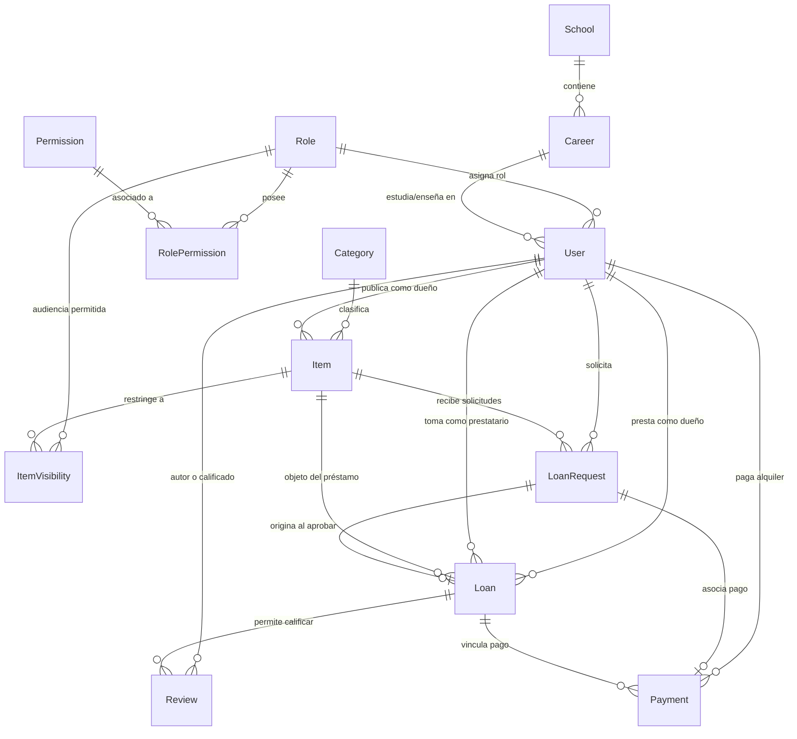
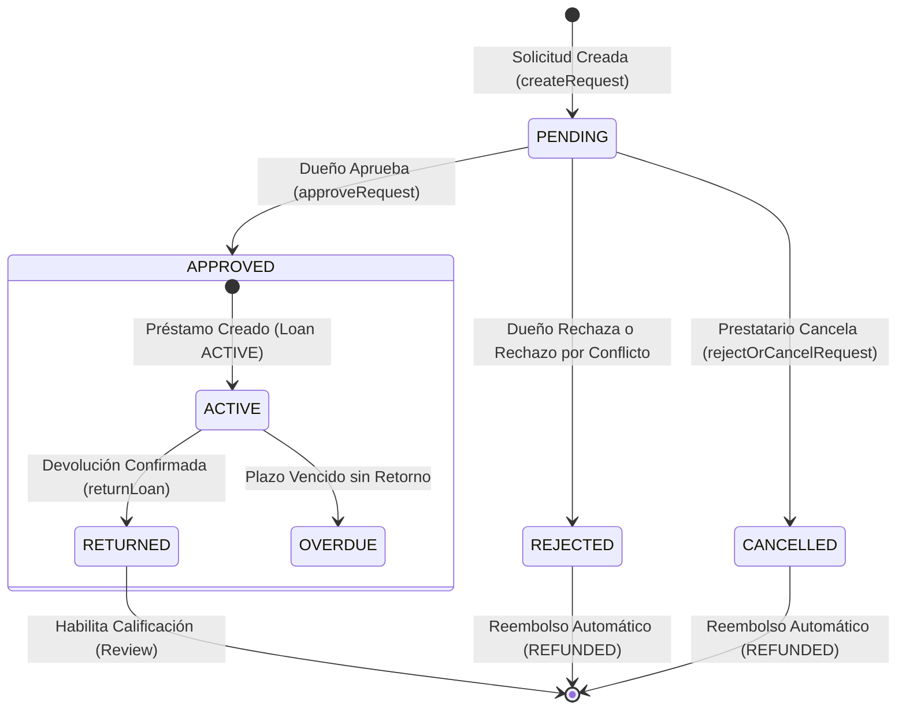

# Modelado y Base de Datos Prisma (`prisma/`)

Esta carpeta define la arquitectura relacional en PostgreSQL para LendIt UJAP, gestionando esquemas, relaciones, índices, enumeraciones, triggers y migraciones mediante Prisma ORM con el adaptador `@prisma/adapter-pg`.

---

## 1. Diagrama Entidad-Relación (ERD)



---

## 2. Enumeraciones del Dominio (`enums`)

| Enumeración | Valores Posibles | Propósito y Reglas de Negocio |
|---|---|---|
| `ItemStatus` | `AVAILABLE`, `PAUSED`, `LENT`, `REJECTED` | Estado del artículo: disponible para solicitar, pausado por el dueño, actualmente en préstamo o rechazado por revisión. |
| `ItemMode` | `LOAN`, `RENTAL` | `LOAN`: préstamo gratuito sin costo monetario. `RENTAL`: requiere definir precio positivo y divisa. |
| `LoanRequestStatus` | `PENDING`, `APPROVED`, `REJECTED`, `CANCELLED`, `EXPIRED` | Flujo de la solicitud desde su emisión hasta su resolución por el dueño o el sistema. |
| `LoanStatus` | `ACTIVE`, `RETURNED`, `OVERDUE`, `CANCELLED` | Ciclo del préstamo físico: activo tras entrega, devuelto formalmente, retrasado o cancelado. |
| `PaymentStatus` | `PENDING`, `SIMULATED_PAID`, `FAILED`, `REFUNDED` | Estado financiero del pago simulado o procesado; reembolsado automáticamente si la solicitud es rechazada o cancelada. |
| `Currency` | `USD`, `EUR`, `VES` | Divisas soportadas para la fijación de precios y pagos de alquileres. |

---

## 3. Especificación Detallada de Modelos y Columnas

### `User` (Perfil de Usuario y Carnet Digital)
Representa la identidad en el campus y el historial de confianza, sincronizado con Supabase Auth.

| Campo | Tipo SQL | Restricciones / Índices | Descripción |
|---|---|---|---|
| `id` | `UUID` | `@id`, `@default(uuid())` | Identificador único primario del usuario en LendIt. |
| `authUserId` | `UUID` | `@unique`, nullable | Llave foránea lógica hacia `auth.users(id)` en Supabase. |
| `email` | `VARCHAR(254)` | `@unique` | Correo institucional único (`@ujap.edu.ve`) o administrativo. |
| `firstName` | `VARCHAR(80)` | No nulo | Primer nombre del estudiante o profesor. |
| `lastName` | `VARCHAR(80)` | No nulo | Apellidos del usuario. |
| `phone` | `VARCHAR(30)` | No nulo | Número telefónico de contacto para coordinar entregas. |
| `photoUrl` | `TEXT` | Nullable | URL pública de la foto en Supabase Storage (bucket `item-photos`). |
| `roleId` | `UUID` | `FK -> Role(id)`, indexado | Rol asignado (ej. `STUDENT`, `PROFESSOR`, `ADMIN`). |
| `careerId` | `UUID` | `FK -> Career(id)` | Carrera universitaria a la que pertenece. |
| `isActive` | `BOOLEAN` | `@default(true)` | Control administrativo: desactiva el acceso sin borrar el historial. |
| `reliabilityScore`| `DECIMAL(5,2)` | `@default(0)` | Calificación promedio acumulada de reputación (1.00 a 5.00). |
| `reliabilityReviewCount` | `INT` | `@default(0)` | Contador de reseñas recibidas tras finalizar préstamos. |
| `createdAt` / `updatedAt` | `TIMESTAMP` | `@default(now())`, `@updatedAt` | Marcas de tiempo de auditoría. |

---

### `Item` (Objetos Publicados)
Artículos disponibles para circular entre la comunidad universitaria.

| Campo | Tipo SQL | Restricciones / Índices | Descripción |
|---|---|---|---|
| `id` | `UUID` | `@id`, `@default(uuid())` | Identificador único del artículo. |
| `code` | `VARCHAR(40)` | `@unique` | Código único visible (ej. `#UJAP-7F8A1B2C`). |
| `ownerId` | `UUID` | `FK -> User(id)`, indexado `[ownerId, status]` | Propietario del objeto. |
| `categoryId`| `UUID` | `FK -> Category(id)`, indexado `[categoryId, status]` | Clasificación temática del objeto. |
| `title` | `VARCHAR(160)` | No nulo | Título descriptivo (ej. "Calculadora HP Prime"). |
| `description` | `TEXT` | Nullable | Detalles de uso, accesorios o estado físico. |
| `duration` | `VARCHAR(80)` | Nullable | Plazo sugerido o estimado (ej. "3 días", "1 semana"). |
| `photoUrl` | `TEXT` | Nullable | Imagen del objeto subida a Supabase Storage. |
| `mode` | `ItemMode` | `@default(LOAN)` | `LOAN` (gratis) o `RENTAL` (de pago). |
| `price` | `DECIMAL(12,2)` | Nullable | Monto requerido si `mode === RENTAL`. |
| `currency` | `Currency` | Nullable | Moneda del precio (`USD`, `EUR`, `VES`). |
| `status` | `ItemStatus` | `@default(AVAILABLE)` | Disponibilidad actual para recibir préstamos. |

---

### `ItemVisibility` (Control de Audiencia)
Restringe la visualización y posibilidad de solicitud de un artículo a roles específicos.
- **Llave Primaria Compuesta**: `@@id([itemId, roleId])`
- **Comportamiento**: Si un artículo no tiene registros en `ItemVisibility`, es público para cualquier usuario. Si tiene registros, solo los usuarios con los roles listados pueden verlo y pedirlo.

---

### `LoanRequest` (Solicitud de Préstamo / Alquiler)
Representa la intención formal de un prestatario sobre un artículo en un período determinado.

| Campo | Tipo SQL | Restricciones / Índices | Descripción |
|---|---|---|---|
| `id` | `UUID` | `@id` | Identificador único de la solicitud. |
| `itemId` | `UUID` | `FK -> Item(id)`, indexado | Objeto solicitado. |
| `requesterId` | `UUID` | `FK -> User(id)`, indexado | Miembro del campus que solicita el objeto. |
| `startsAt` | `TIMESTAMP` | Indexado `[startsAt, endsAt]` | Fecha y hora pactada para iniciar el préstamo. |
| `endsAt` | `TIMESTAMP` | Indexado `[startsAt, endsAt]` | Fecha y hora límite acordada para devolver el objeto. |
| `message` | `TEXT` | Nullable | Mensaje explicativo o notas para el dueño. |
| `status` | `LoanRequestStatus`| `@default(PENDING)` | Estado actual de aprobación de la solicitud. |

---

### `Loan` (Préstamo Activo o Finalizado)
Se genera únicamente cuando el propietario aprueba una solicitud pendiente.
- Contiene referencias a `itemId`, `ownerId`, `borrowerId` y `requestId`.
- Registra `status` (`ACTIVE`, `RETURNED`, `OVERDUE`) y la marca de tiempo exacta de retorno `returnedAt`.
- Al cerrarse como `RETURNED`, habilita la creación de una reseña en `Review`.

---

### `Review` (Calificaciones de Reputación)
- Restricción única `@@unique([loanId, authorId])`: Cada usuario solo puede calificar una vez por cada préstamo concluido.
- Calificación `rating` entre 1 y 5 con comentario opcional `comment`.

---

### `Payment` (Gestión Financiera de Alquileres)
- Registra montos, divisa, estado (`SIMULATED_PAID`, `REFUNDED`) y referencias de trazabilidad (`providerReference`).
- Se crea automáticamente al solicitar un artículo con modalidad `RENTAL` y se reembolsa si la solicitud es cancelada o rechazada.

---

## 4. Ciclo de Vida y Transiciones de Estado



---

## 5. Triggers de Base de Datos PostgreSQL

1. **Trigger de Alta de Usuario (`auth_user_profile_trigger`)**:
   - Escucha eventos `INSERT` en la tabla `auth.users` de Supabase.
   - Extrae el correo y los metadatos de usuario (`firstName`, `lastName`, `careerId`, `phone`, `photoUrl`).
   - Inserta automáticamente un registro en `public.User` asignando el rol por defecto `STUDENT`.
2. **Trigger de Validación Institucional**:
   - Valida que el correo termine en `@ujap.edu.ve` antes de permitir la persistencia en `User`, a menos que se trate de una cuenta con rol `ADMIN`.

---

## 6. Comandos de Gestión y Mantenimiento

```bash
# Validar la sintaxis del esquema
npm run db:validate

# Generar el cliente tipado de Prisma en ../generated/prisma
npm run db:generate

# Aplicar migraciones en entorno de desarrollo local
npm run db:migrate

# Desplegar migraciones pendientes en producción
npm run db:migrate:deploy

# Abrir el explorador visual de base de datos
npm run db:studio

# Promover manualmente a un usuario a Administrador
npm run db:promote usuario@ujap.edu.ve ADMIN
```
