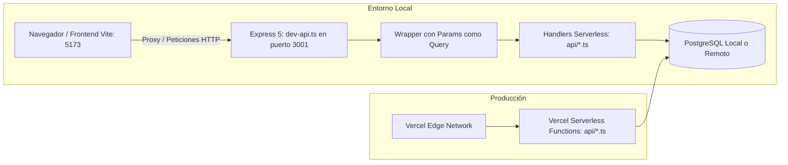

# Servidor de Desarrollo Local (`server/`)

Esta carpeta contiene el servidor de desarrollo local de backend construido con **Express 5** (`server/dev-api.ts`). Su propósito es ejecutar y probar de forma instantánea todos los handlers serverless definidos en `api/*` sin depender del CLI de Vercel (`vercel dev`) ni de credenciales en la nube.

---

## 1. Arquitectura y Mecanismo de Emulación

En producción, Vercel compila cada archivo `.ts` de la carpeta `api/` como una función serverless independiente bajo demanda de AWS Lambda. En desarrollo local, `server/dev-api.ts` monta todos esos mismos handlers bajo una sola aplicación de Express.



---

## 2. Desafíos Técnicos Resueltos en `dev-api.ts`

### 1. Compatibilidad con Express 5 y Rutas Dinámicas
En Vercel Serverless, los parámetros de rutas dinámicas (como `api/roles/[id].ts` o `api/categories/:key`) se inyectan automáticamente en `req.query.id` o `req.query.key`. Sin embargo, en Express los parámetros de ruta (`:id`) se almacenan en `req.params`.

Además, en **Express 5** la propiedad `req.query` es de **solo lectura**. Si se intenta mutar `req.query.id = req.params.id`, Express arroja un error en tiempo de ejecución.

Para resolver esto sin alterar los controladores originales, `dev-api.ts` implementa la función envoltorio `withParamsAsQuery`:

```typescript
function withParamsAsQuery(handler: (req: Request, res: Response) => unknown) {
  return wrap((req, res) => {
    // Crea un prototipo derivado del request original con la query combinada de forma inmutable
    const requestWithMergedQuery = Object.create(req, {
      query: { value: { ...req.query, ...req.params }, enumerable: true },
    }) as Request
    return handler(requestWithMergedQuery, res)
  })
}
```

### 2. Captura Global de Errores No Controlados (`wrap`)
Garantiza que cualquier rechazo de promesa no capturado (*unhandled rejection*) o excepción imprevista dentro de un handler no tire abajo el proceso del servidor local:

```typescript
function wrap(handler: (req: Request, res: Response) => unknown) {
  return async (req: Request, res: Response) => {
    try {
      await handler(req, res)
    } catch (error) {
      console.error('Unhandled API error', error)
      res.status(500).json({ ok: false, error: 'INTERNAL_ERROR' })
    }
  }
}
```

---

## 3. Mapeo Completo de Endpoints y Reescrituras

| Ruta Express Local | Handler Serverless Invocado | Emulación de Parámetros | Equivalente en Vercel |
|---|---|---|---|
| `/api/health` | `api/health.ts` | Ninguna | `api/health.ts` |
| `/api/items` | `api/items.ts` | Ninguna | `api/items.ts` |
| `/api/me` | `api/me.ts` | Ninguna | `api/me.ts` |
| `/api/categories` | `api/categories.ts` | Ninguna | `api/categories.ts` |
| `/api/categories/:key` | `api/categories.ts` | `req.params.key` $\to$ `req.query.key` | Rewrite en `vercel.json`: `/api/categories/:key` $\to$ `/api/categories?key=:key` |
| `/api/careers` | `api/careers.ts` | Ninguna | `api/careers.ts` |
| `/api/careers/:id` | `api/careers.ts` | `req.params.id` $\to$ `req.query.id` | Rewrite en `vercel.json`: `/api/careers/:id` $\to$ `/api/careers?id=:id` |
| `/api/schools` | `api/schools.ts` | Ninguna | `api/schools.ts` |
| `/api/roles` | `api/roles.ts` | Ninguna | `api/roles.ts` |
| `/api/roles/:id` | `api/roles/[id].ts` | `req.params.id` $\to$ `req.query.id` | Segmento dinámico Vercel `[id]` |
| `/api/permissions` | `api/permissions.ts` | Ninguna | `api/permissions.ts` |
| `/api/users` | `api/users.ts` | Ninguna | `api/users.ts` |
| `/api/users/:id` | `api/users/[id].ts` | `req.params.id` $\to$ `req.query.id` | Segmento dinámico Vercel `[id]` |
| `/api/users/:id/reset-password` | `api/users/[id]/reset-password.ts` | `req.params.id` $\to$ `req.query.id` | Segmento dinámico Vercel `[id]` |

---

## 4. Ejecución del Servidor

```bash
# Iniciar solo el servidor de API en modo observador (watch con tsx)
npm run dev:api

# Iniciar concurrentemente el frontend de Vite y el servidor de API
npm run dev:full
```
