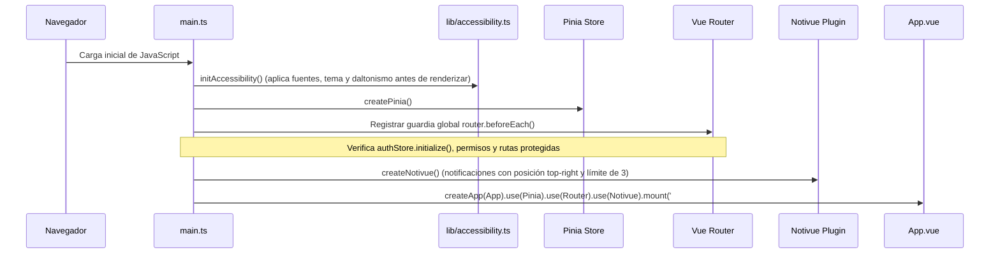

# Entrada Principal y Sistema de Diseño del Frontend (`src/`)

Esta carpeta es la raíz del frontend de LendIt UJAP. Contiene el punto de arranque de la aplicación Vue 3, el componente raíz con soporte para notificaciones flotantes globales, el sistema de diseño visual en CSS vanilla y la estructura de directorios modulares de la interfaz de usuario.

---

## 1. Flujo de Inicialización (`main.ts`)



### Funciones y Configuraciones en `main.ts`
1. **Pre-inicialización de Accesibilidad (`initAccessibility`)**:
   - Se ejecuta antes del montaje del DOM para evitar destellos de estilo (*flash of unstyled content*) al cargar preferencias almacenadas en `localStorage`.
2. **Guardia Global de Navegación (`router.beforeEach`)**:
   - Inicializa de forma asíncrona la sesión en Supabase (`await authStore.initialize()`).
   - Comprueba si la ruta de destino exige un permiso administrativo (`to.meta.requiredPermission`):
     - Si el usuario carece de dicho permiso, lo redirige a `/admin/login` conservando la ruta previa en el parámetro de consulta `redirect`.
   - Comprueba si la ruta de destino requiere autenticación institucional (`to.meta.requiresAuth`):
     - Si el usuario no ha iniciado sesión, lo redirige a `/login?redirect=...`.
3. **Instalación de Plugins**:
   - `Pinia`: Gestor reactivo de estado global.
   - `Vue Router`: Enrutador cliente SPA con historial HTML5.
   - `Notivue`: Sistema de notificaciones flotantes con pausa al pasar el puntero (`pauseOnHover: true`) o tocar en móviles (`pauseOnTouch: true`).

---

## 2. Componente Raíz (`App.vue`)

Gestiona la capa superior de la interfaz y la integración visual de las notificaciones del sistema.

### Tokens del Tema de Notivue (`lenditTheme`)
Personaliza la apariencia de las notificaciones flotantes adaptándolas a los colores institucionales de la Universidad José Antonio Páez:

| Token CSS | Valor | Propósito |
|---|---|---|
| `--nv-width` | `360px` | Ancho de las tarjetas de notificación flotante. |
| `--nv-radius` | `0.75rem` (12px) | Bordes redondeados acordes al diseño de tarjetas. |
| `--nv-global-bg` | `var(--paper-2)` | Fondo adaptativo según el tema activo (claro u oscuro). |
| `--nv-global-fg` | `var(--ink)` | Color principal del texto de la notificación. |
| `--nv-success-accent`| `var(--gold)` | Acento dorado para notificaciones de éxito y préstamos aprobados. |
| `--nv-info-accent` | `var(--crimson)` | Acento vino tinto institucional para avisos y novedades. |
| `--nv-error-accent`| `var(--crimson-dark)` | Acento oscuro para alertas de error o validación. |

---

## 3. Sistema de Diseño Global (`style.css`)

El archivo `style.css` define las variables de CSS nativas (*CSS custom properties*), la tipografía y los estilos base de la plataforma sin dependencias pesadas como TailwindCSS.

### Tokens de Color Principales
```css
:root {
  /* Identidad Institucional UJAP */
  --crimson: #7a1c2e;
  --crimson-dark: #581421;
  --crimson-bg: rgba(122, 28, 46, 0.08);
  --gold: #b38b47;
  --gold-light: #d8b878;
  --gold-bg: rgba(179, 139, 71, 0.12);
  --navy: #0f1a2e;

  /* Superficies y Textos */
  --ink: #1b1f24;
  --ink-soft: #4a5568;
  --ink-faint: #718096;
  --paper: #f8fafc;
  --paper-2: #ffffff;
  --line: rgba(15, 26, 46, 0.08);
  --line-strong: rgba(15, 26, 46, 0.16);

  /* Sombras y Elevaciones */
  --shadow-soft: 0 4px 18px rgba(15, 26, 46, 0.06);
  --shadow: 0 12px 32px rgba(15, 26, 46, 0.12);
}
```

### Modos Alternativos de Visualización
- **Tema Oscuro (`[data-theme="dark"]`)**: Invierte las superficies a fondos oscuros (`#0b121e`, `#121b2b`) manteniendo contrastes de texto legibles.
- **Modo Daltonismo (`[data-colorblind]`)**: Reemplaza acentos rojos por azules de alto contraste para evitar confusión entre estados de éxito y alerta en usuarios con daltonismo.
