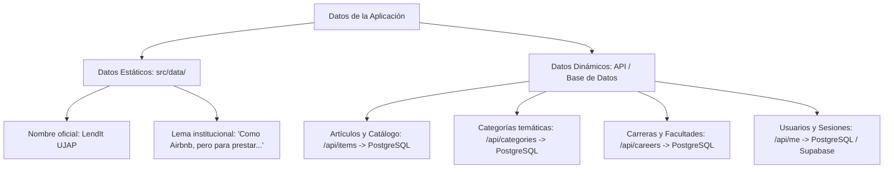

# Datos Estáticos y Constantes Institucionales (`src/data/`)

Esta carpeta alberga los identificadores fijos y textos de marca institucionales de LendIt UJAP. Separa el contenido puramente inmutable de la aplicación respecto a los datos dinámicos que se obtienen de la base de datos PostgreSQL mediante la API.

---

## 1. Arquitectura de Separación de Datos



---

## 2. Archivos y Funciones

### `app.ts` — Textos Institucionales

```typescript
export function getAppName(): string {
  return 'LendIt UJAP'
}

export function getAppTagline(): string {
  return 'Como Airbnb, pero para prestar cosas entre estudiantes por tiempo limitado.'
}
```

| Función | Parámetros | Retorno | Uso en la Aplicación |
|---|---|---|---|
| `getAppName()` | Ninguno | `string` | Retorna el nombre comercial oficial de la plataforma (`'LendIt UJAP'`). Se utiliza en el título de la cabecera institucional (`SiteHeader.vue`) y en los metadatos de accesibilidad. |
| `getAppTagline()` | Ninguno | `string` | Retorna el eslogan del proyecto. Se despliega en el hero principal de la página de bienvenida (`LandingView.vue`) y en los pies de página. |

---

### `index.ts` — Punto de Re-exportación

Centraliza las exportaciones de la carpeta para permitir importaciones limpias en componentes y vistas:

```typescript
export * from './app'
```

---

### `app.spec.ts` — Pruebas Unitarias de Regresión

Pruebas automatizadas con Vitest que garantizan que las cadenas institucionales no sean alteradas accidentalmente durante refactorizaciones:
- Verifica que `getAppName()` retorne `'LendIt UJAP'`.
- Verifica que `getAppTagline()` contenga la frase explicativa del servicio de préstamos.
