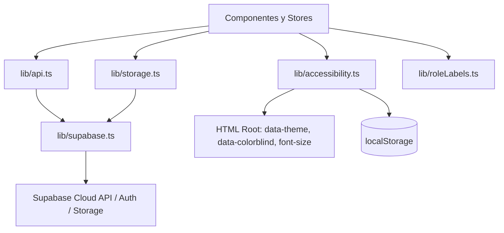

# Librerías y Módulos de Soporte del Frontend (`src/lib/`)

Esta carpeta contiene utilidades compartidas, clientes de servicios en la nube (Supabase, Storage), la capa centralizada de peticiones HTTP autenticadas y el sistema de preferencias de accesibilidad de LendIt UJAP.

---

## 1. Módulos y Arquitectura de Integración



---

## 2. Especificación Técnica por Módulo

### `accessibility.ts` — Sistema de Accesibilidad y Temas
Controla la apariencia del sistema para garantizar inclusión visual y usabilidad en diversas condiciones de iluminación y capacidades sensoriales.

#### Variables Reactivas Exportadas
- `fontSize: Ref<FontSize>`: Escala de tamaño base de fuente (`'normal'` $\to$ 17px, `'large'` $\to$ 19px, `'larger'` $\to$ 21px).
- `theme: Ref<ThemeMode>`: Modo de color (`'light'` \| `'dark'`).
- `colorblind: Ref<boolean>`: Booleano para activar paletas de alto contraste adaptadas a daltonismo (protanopía, deuteranopía y tritanopía).

#### Funciones y Lógica de Sincronización

| Función | Parámetros | Retorno | Comportamiento |
|---|---|---|---|
| `readStored()` *(privada)* | Ninguno | `StoredPrefs` | Lee la clave `lendit:accessibility` de `localStorage`. Migra configuraciones heredadas (ej. opciones `'system'` a `'light'`) y retorna un objeto seguro con valores por defecto si el storage está bloqueado o vacío. |
| `applyToDocument()` *(privada)* | Ninguno | `void` | Aplica directamente las propiedades en el elemento raíz `document.documentElement`:<br>1. `root.style.fontSize = FONT_SIZE_PX[fontSize.value]`<br>2. `root.setAttribute('data-theme', theme.value)`<br>3. `root.toggleAttribute('data-colorblind', colorblind.value)`<br>4. Persiste la configuración serializada en `localStorage`. |
| `initAccessibility()` | Ninguno | `void` | Se invoca síncronamente en `main.ts` antes de montar Vue. Aplica las preferencias almacenadas y registra un `watch([fontSize, theme, colorblind], applyToDocument)` reactivo que propaga cualquier cambio inmediatamente a todo el DOM. |

---

### `api.ts` — Cliente HTTP Autenticado
Capa de abstracción sobre la API `fetch` nativa del navegador para estandarizar encabezados, autorización JWT y control de errores.

#### Firma y Funcionamiento
```typescript
export async function apiRequest<T>(path: string, init: RequestInit = {}): Promise<T>
```

#### Flujo Operativo de `apiRequest`
1. **Inyección de Tokens JWT**:
   - Consulta `getSupabaseClient().auth.getSession()`.
   - Si existe una sesión activa, inyecta automáticamente la cabecera `Authorization: Bearer <access_token>`.
2. **Encabezados de Contenido**:
   - Si la solicitud incluye un cuerpo (`init.body`) y no tiene definido `Content-Type`, añade automáticamente `Content-Type: application/json`.
3. **Prefijo de Entorno**:
   - Concatena la variable de entorno `VITE_API_BASE_URL` al inicio de la ruta si está configurada.
4. **Manejo Centralizado de Errores**:
   - Si `response.ok` es falso, parsea el JSON de respuesta y extrae el mensaje de error del payload (`payload.error` o `payload.message`), lanzando una excepción `new Error(...)` para que los componentes y stores puedan capturarla y mostrar alertas amigables al usuario.

---

### `storage.ts` — Gestión de Fotos en Supabase Storage
Administra la subida y depuración de imágenes de artículos y perfiles en el bucket `item-photos`.

#### Funciones

| Función | Firma | Comportamiento y Reglas |
|---|---|---|
| `uploadItemPhoto` | `(dataUrl: string): Promise<string>` | 1. Valida que el usuario tenga sesión activa (obtiene su `userId`).<br>2. Convierte el `dataUrl` en un objeto `Blob` binario.<br>3. Genera una ruta única bajo el espacio del usuario: `${userId}/${crypto.randomUUID()}.jpg`.<br>4. Sube la imagen con `contentType: 'image/jpeg'` y cabecera de caché de 1 año (`cacheControl: '31536000'`).<br>5. Retorna la URL pública generada por Supabase CDN. |
| `removeItemPhoto` | `(photoUrl: string \| null \| undefined): Promise<void>` | Extrae la ruta relativa interna del archivo dentro del bucket `item-photos` a partir de su URL pública y solicita el borrado físico del objeto en el servidor para evitar almacenamiento huérfano. |

---

### `supabase.ts` — Cliente SDK de Supabase
Provee la instancia singleton de `@supabase/supabase-js` para el frontend.

- **Configuración de Sesión**:
  - `autoRefreshToken: true`: Renueva automáticamente los tokens de acceso antes de su expiración.
  - `detectSessionInUrl: true`: Captura tokens en la URL tras flujos de confirmación de correo o recuperación de contraseña.
  - `persistSession: true`: Almacena la sesión en el almacenamiento local del navegador.

---

### `roleLabels.ts` — Traducción y Protección de Roles

- **Traducción (`roleLabel`)**: Convierte identificadores técnicos de base de datos a español comprensible:
  - `ADMIN` $\to$ `'Administrador'`
  - `STUDENT` $\to$ `'Estudiante'`
  - `PROFESSOR` $\to$ `'Profesor'`
- **Protección (`isProtectedRole`)**: Comprueba si un rol pertenece a `PROTECTED_ROLE_NAMES = ['ADMIN', 'STUDENT', 'PROFESSOR']` para impedir que sea modificado o eliminado accidentalmente en los paneles de administración.
