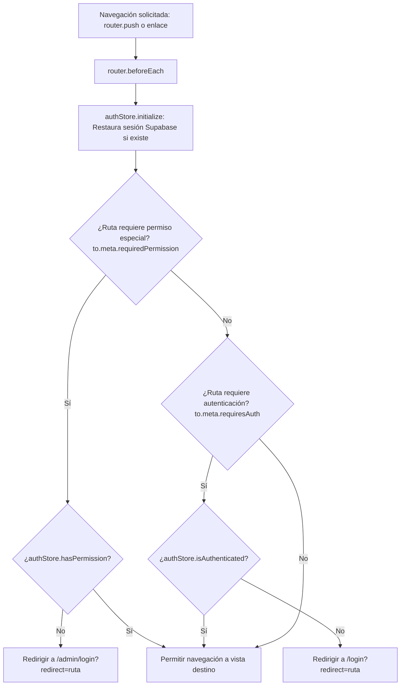
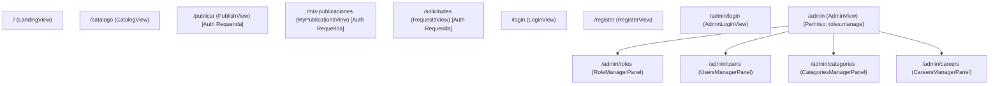

# Enrutamiento de la Aplicación (`src/router/`)

Esta carpeta configura el sistema de enrutamiento del lado del cliente utilizando Vue Router 4 (`createRouter` y `createWebHistory`) para la navegación fluida tipo SPA (*Single Page Application*) en LendIt UJAP.

---

## 1. Arquitectura de Navegación y Guardias de Seguridad



---

## 2. Mapa Detallado de Rutas



---

## 3. Especificación de Rutas y Metadatos

| Ruta (`path`) | Nombre (`name`) | Componente Asignado | Metadatos (`meta`) | Propósito Funcional |
|---|---|---|---|---|
| `/` | `landing` | `LandingView.vue` | — | Presentación general de la plataforma, cómo funciona y categorías destacadas. |
| `/catalogo` | `catalog` | `CatalogView.vue` | — | Directorio de objetos disponibles para préstamo o alquiler con búsqueda en vivo. |
| `/publicar` | `publish` | `PublishView.vue` | `{ requiresAuth: true }` | Formulario de publicación de un nuevo objeto para la comunidad universitaria. |
| `/mis-publicaciones` | `my-publications` | `MyPublicationsView.vue` | `{ requiresAuth: true }` | Gestión de artículos publicados por el usuario (edición, pausa y borrado). |
| `/solicitudes` | `requests` | `RequestsView.vue` | `{ requiresAuth: true }` | Gestión de solicitudes de préstamo entrantes y salientes. |
| `/login` | `login` | `LoginView.vue` | — | Acceso para la comunidad UJAP con correo institucional. |
| `/register` | `register` | `RegisterView.vue` | — | Creación de cuenta institucional con selección de carrera y foto de perfil. |
| `/admin/login` | `admin-login` | `AdminLoginView.vue` | — | Acceso restringido para personal con permisos de administración. |
| `/admin` | `admin` | `AdminView.vue` | `{ requiredPermission: 'roles.manage' }` | Contenedor principal con barra lateral para la gestión del campus. Redirige por defecto a `admin-roles`. |
| `/admin/roles` | `admin-roles` | `RoleManagerPanel.vue` | *(Heredado)* | Matriz de permisos y creación de nuevos roles. |
| `/admin/users` | `admin-users` | `UsersManagerPanel.vue` | *(Heredado)* | Supervisión de usuarios registrados, roles y reseteo de claves. |
| `/admin/categories` | `admin-categories` | `CategoriesManagerPanel.vue` | *(Heredado)* | Mantenimiento de categorías y emojis. |
| `/admin/careers` | `admin-careers` | `CareersManagerPanel.vue` | *(Heredado)* | Mantenimiento de carreras académicas y escuelas. |

---

## 4. Gestión de Redirecciones y Parámetros

Cuando un usuario no autenticado intenta acceder a una ruta protegida (por ejemplo `/publicar`), el guardia de navegación preserva el destino original inyectando el parámetro `redirect`:

```typescript
if (to.meta.requiresAuth === true && !authStore.isAuthenticated) {
  return { name: 'login', query: { redirect: to.fullPath } }
}
```

Una vez que el usuario inicia sesión exitosamente en `LoginView.vue` o `AdminLoginView.vue`, el sistema lee `route.query.redirect` y lo redirige automáticamente a la pantalla que intentaba consultar originalmente.
