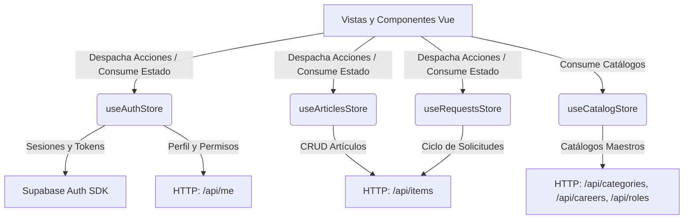
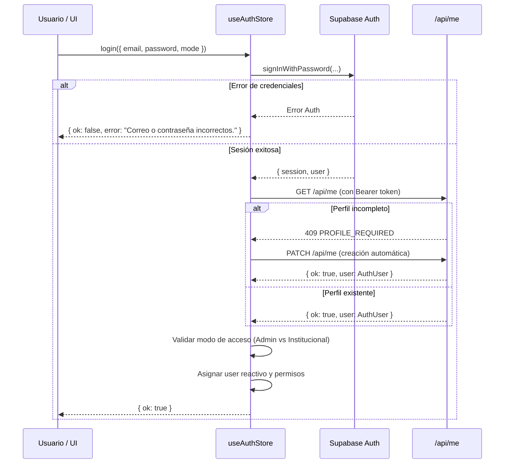

# Manejo de Estado Global con Pinia (`src/stores/`)

Esta carpeta centraliza el estado reactivo global de la aplicación utilizando Pinia. Implementa una separación estricta entre la interfaz de usuario y la lógica de consumo de APIs, sincronización de sesiones con Supabase y persistencia en memoria reactiva.

---

## 1. Arquitectura de Stores y Flujos de Datos

---

## 2. Especificación Técnica de Almacenes

### `auth.ts` (`useAuthStore`)
Gestiona el ciclo de vida de la identidad del usuario, tokens de acceso y matriz de permisos.

#### Diagrama de Secuencia de Autenticación y Sincronización

#### Métodos y Acciones en Detalle

| Método | Firma | Descripción y Comportamiento Reactivo |
|---|---|---|
| `initialize()` | `(): Promise<void>` | Se ejecuta en el guardia global de navegación (`router.beforeEach`). Comprueba si existe una sesión previa en `localStorage`, llama a `syncProfile()` y registra un listener reactivo `supabase.auth.onAuthStateChange` para reaccionar a refrescos de token o cierres de sesión externos. |
| `syncProfile(session?)` | `(session?: Session \| null): Promise<void>` | Obtiene el token JWT y realiza una petición a `/api/me`. Si la cuenta no tenía perfil creado, dispara automáticamente un `PATCH /api/me` para crearlo a partir de los metadatos de Supabase Auth. Asigna el resultado a `this.user`. |
| `register(input)` | `(input: RegisterInput): Promise<AuthResult>` | Valida campos requeridos, contraseña $\ge 6$ caracteres y correo `@ujap.edu.ve`. Invoca `supabase.auth.signUp()`. Si se inicia sesión de inmediato, sube la foto de perfil al bucket de Supabase Storage mediante `uploadItemPhoto()` y actualiza el perfil con `/api/me`. |
| `login(credentials)` | `(credentials: LoginCredentials): Promise<AuthResult>` | Valida sintaxis de correo según el modo (`institutional` exige `@ujap.edu.ve`; `admin` admite formatos estándar). Autentica vía Supabase, sincroniza perfil y comprueba que las cuentas con rol `ADMIN` no ingresen por el portal estudiantil y viceversa. |
| `logout()` | `(): Promise<void>` | Limpia de forma síncrona `this.user = null` para que la interfaz se desmonte inmediatamente sin parpadeos, y luego ejecuta `supabase.auth.signOut()`. |

---

### `articles.ts` (`useArticlesStore`)
Administra los artículos publicados en la red (catálogo general y publicaciones propias del usuario).

#### Métodos y Acciones en Detalle

| Método | Firma | Descripción y Comportamiento Reactivo |
|---|---|---|
| `initialize()` | `(): Promise<void>` | Carga el catálogo si no ha sido inicializado previamente, previniendo llamadas de red redundantes entre cambios de ruta. |
| `load()` | `(): Promise<void>` | Ejecuta `GET /api/items`. Actualiza el estado reactivo `this.articles` con los objetos disponibles para el rol del usuario actual. |
| `publish(input)` | `(input: NewArticleInput): Promise<Article>` | Envía `POST /api/items`. Tras la confirmación del servidor, vuelve a ejecutar `load()` para refrescar el catálogo público y devuelve el artículo creado. |
| `loadMine()` | `(): Promise<void>` | Ejecuta `GET /api/items?mine=1` para poblar `this.myArticles` con los artículos propios del usuario (activos y pausados). |
| `update(id, input)` | `(id: string, input: UpdateArticleInput): Promise<Article>` | Envía `PATCH /api/items`. Actualiza el objeto en memoria local en `this.myArticles` y recarga el catálogo global mediante `load()`. |
| `setStatus(id, status)` | `(id: string, status: 'available' \| 'paused'): Promise<Article>` | Atajo de conveniencia que llama a `update()` modificando únicamente el estado del objeto para pausar o reactivar su visibilidad pública. |
| `remove(id)` | `(id: string): Promise<...>` | Envía `DELETE /api/items` y filtra el elemento eliminado de `this.myArticles` y `this.articles` reactivamente. |

---

### `requests.ts` (`useRequestsStore`)
Gestiona el ciclo de vida de solicitudes de préstamo entrantes y salientes.

#### Métodos y Acciones en Detalle

| Método | Firma | Descripción y Comportamiento Reactivo |
|---|---|---|
| `load()` | `(): Promise<void>` | Consulta `GET /api/items?view=requests` y guarda las solicitudes en `this.requests`. |
| `create(input)` | `(input: NewLoanRequestInput): Promise<LoanRequest \| null>` | Envía `POST /api/items` con `{ resource: 'request', ...input }` para crear una solicitud de préstamo o alquiler en un rango de fechas. |
| `act(input)` | `(input: RequestAction): Promise<LoanRequest \| null>` | Envía `PATCH /api/items` con `{ resource: 'request', action, ... }` para ejecutar transiciones de estado (`approve`, `reject`, `cancel`, `return`). |

---

### `catalog.ts` (`useCatalogStore`)
Gestiona los datos maestros y listas desplegables compartidas en la plataforma.

#### Métodos y Acciones en Detalle

| Método | Firma | Descripción y Comportamiento Reactivo |
|---|---|---|
| `initialize()` | `(): Promise<void>` | Ejecuta en paralelo (`Promise.all`) las cargas de `loadCategories()`, `loadCareers()` y `loadSchools()`. Marca `isInitialized = true`. |
| `loadCategories()` | `(): Promise<void>` | Consulta `GET /api/categories` y almacena las categorías con etiquetas, iconos y descripciones breves. |
| `loadCareers()` | `(): Promise<void>` | Consulta `GET /api/careers` y almacena las carreras asociadas a escuelas. |
| `loadSchools()` | `(): Promise<void>` | Consulta `GET /api/schools` y guarda las facultades/escuelas universitarias. |
| `loadRoles()` | `(): Promise<void>` | Consulta `GET /api/roles` (requiere sesión activa) para alimentar los selectores de audiencia de artículos y el panel de administración. |
