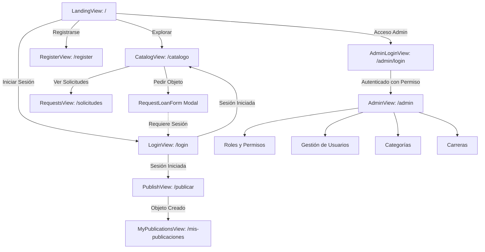

# Vistas Principales de la Aplicación (`src/views/`)

Esta carpeta alberga las vistas o páginas de nivel superior del frontend. Cada vista orquesta la composición de componentes, gestiona el estado reactivo de su pantalla, interactúa con los almacenes de Pinia y responde a los eventos de navegación de Vue Router.

---

## 1. Mapa de Vistas y Flujo de Usuario

---

## 2. Detalle Exhaustivo de Vistas y Lógica de Negocio

### `LandingView.vue` (`/`)
Página de bienvenida de la red de préstamos universitaria.

- **Componentes Empleados**: `SiteHeader`, `CategoryCard`, `StepCard`, `SiteFooter`.
- **Persistencia de Pasos Leídos**: Utiliza la utilidad `useLocalStorage` de `@vueuse/core` vinculada a la clave `lendit:completed-steps` para marcar interactivamente qué pasos del proceso ("Publica lo que no usas", "Pide lo que necesitas", "Devuelve a tiempo") han sido completados por el visitante.
- **Redirección Contextual (`openPublish`)**: Si un usuario no autenticado hace clic en "Publicar un objeto", la vista lo redirige a `/login?redirect=/publicar` para que, tras iniciar sesión, el sistema lo conduzca automáticamente a la pantalla de publicación.

---

### `CatalogView.vue` (`/catalogo`)
Explorador del catálogo de artículos disponibles en el campus.

- **Filtro y Búsqueda en Memoria (`filteredArticles`)**:
  - Filtro por categoría seleccionada (`selectedCategory: 'all' | categoryKey`).
  - Búsqueda en tiempo real sobre título, categoría, duración y descripción sin peticiones adicionales al servidor.
- **Flujo de Solicitud de Préstamo (`handleRequest`)**:
  - Si el usuario no ha iniciado sesión, guarda el estado y redirige a `/login?redirect=/catalogo`.
  - Si el usuario es el dueño del artículo, muestra una notificación preventiva indicando que no puede auto-solicitarse su propio objeto.
  - Si es apto, abre el diálogo modal con el componente `RequestLoanForm` preconfigurado con el artículo elegido.
  - Al recibir el evento `submitted`, cierra el modal, muestra la notificación flotante de Notivue y actualiza el catálogo.

---

### `PublishView.vue` (`/publicar`)
Pantalla dedicada a dar de alta un nuevo objeto en el sistema.

- **Ruta Protegida**: Requiere sesión activa (`meta: { requiresAuth: true }`).
- **Lógica de Publicación (`handlePublished`)**: Tras la emisión del evento `published` por parte del formulario `PublishArticleForm`, muestra una notificación de éxito con Notivue y reemplaza la ruta hacia `/mis-publicaciones` para que el estudiante visualice su nuevo objeto de inmediato.

---

### `MyPublicationsView.vue` (`/mis-publicaciones`)
Panel de administración personal para los objetos publicados por el usuario.

- **Métricas Superiores**: Contadores computados de artículos disponibles (`availableCount`) y pausados (`pausedCount`).
- **Edición Completa (`openEdit`)**: Abre un diálogo modal con `PublishArticleForm` cargado con los datos del artículo existente para modificar descripciones, plazos, modalidades o fotos.
- **Pausa y Reactivación (`toggleStatus`)**: Invoca de forma asíncrona `articlesStore.setStatus(article.id, nuevoEstado)`, alternando la visibilidad del objeto en el catálogo público sin tener que eliminarlo.
- **Eliminación Segura con Confirmación (`askDelete` y `confirmDelete`)**:
  - Abre un diálogo modal de confirmación advirtiendo que la acción no se puede deshacer.
  - Comprueba en el backend que el objeto no tenga préstamos activos ni solicitudes pendientes.
  - Elimina el registro del artículo y remueve la imagen física en Supabase Storage mediante `removeItemPhoto()`.

---

### `RequestsView.vue` (`/solicitudes`)
Centro de control de préstamos para coordinar entregas y devoluciones.

- **Segmentación de Solicitudes**:
  - **Recibidas (`incomingRequests`)**: Solicitudes de terceros sobre objetos de los cuales el usuario es el propietario legítimo.
  - **Enviadas (`outgoingRequests`)**: Solicitudes que el usuario realizó sobre objetos de otros compañeros.
- **Acciones Disponibles por Rol**:
  - **Como Dueño**: Puede aprobar (`approve`) o rechazar (`reject`) solicitudes pendientes.
  - **Como Solicitante**: Puede cancelar (`cancel`) su solicitud pendiente si ya no requiere el objeto.
  - **Cualquiera de las Partes**: Puede marcar la devolución física del objeto (`return`), lo que restaura automáticamente la disponibilidad del artículo a `AVAILABLE` en el catálogo general.

---

### `AdminView.vue` (`/admin`)
Panel de control del campus universitario reservado para usuarios con permiso `roles.manage`.

- **Navegación Lateral por Pestañas**:
  - **Roles y Permisos (`/admin/roles`)**: Carga el componente `RoleManagerPanel`.
  - **Usuarios (`/admin/users`)**: Carga el componente `UsersManagerPanel`.
  - **Categorías (`/admin/categories`)**: Carga el componente `CategoriesManagerPanel`.
  - **Carreras y Escuelas (`/admin/careers`)**: Carga el componente `CareersManagerPanel`.
- **Sincronización de Rutas**: Utiliza `router-view` anidado con rutas hijas para permitir navegación directa por URL y marcadores en el navegador.

---

### `LoginView.vue`, `RegisterView.vue` y `AdminLoginView.vue`
Vistas de autenticación adaptadas según el contexto del usuario.

- Envueltas por el layout `AuthPageShell` con estética unificada.
- Mantienen el parámetro `redirect` en la URL para devolver al usuario a la pantalla en la que se encontraba previamente una vez culminado el ingreso exitoso.
